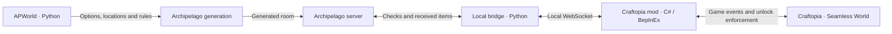

# Craftopia Archipelago

**Turn an open-world crafting adventure into a connected multiworld run.**

An unofficial integration for **Craftopia — Seamless World** and [Archipelago](https://archipelago.gg/). Complete activities in Craftopia to send rewards across a shared game session, then use incoming equipment, crafting and skill unlocks to progress toward a regional goal.

[**Download v1.18.2**](https://github.com/Akamarus/craftopia-archipelago/releases/latest) · [Installation](docs/INSTALLATION.md) · [Project documentation](docs/README.md) · [Report an issue](https://github.com/Akamarus/craftopia-archipelago/issues)

**Windows PC · Archipelago 0.6.8 · Experimental regional alpha**

## The experience

Craftopia combines exploration, crafting, combat and automation in an open world. This integration turns those overlapping systems into a configurable progression network: a mission in one game can unlock a production system or equipment tier in another.

- **Choose a run length.** Six cumulative regional endings span Geezah through Brigandine Valley. Victory requires the selected region's tower completion and main dungeon clear.
- **Turn exploration into checks.** Selected missions, mission-category rewards, one-time Soul Orbs, tower repair stages, age evolutions and main dungeon clears send rewards. Respawning chests are excluded.
- **Build around incoming unlocks.** Progressive equipment permissions, production systems, skill trees, Skill Points and Soul Orb Currency shape the run. Equipment is still crafted or found; new regional seeds also grant a starting weapon kit.
- **Stay in the game.** The F8 Field Guide provides connection controls, enrollment, progression totals, unlock information and received-item history. Notifications explain incoming rewards and blocked actions.
- **Return to the same adventure.** Character enrollment and reward delivery are persisted, with reconnect recovery and safeguards against duplicate starter rewards.

## Get started

1. **Install the release.** Download and extract `Craftopia-Archipelago-1.18.2-Windows.zip`. Close Craftopia and run **Install Bundled Build.cmd**. The package includes its runtime; no compiler or separate Python installation is needed.
2. **Generate a room.** Give the host the included `craftopia.apworld` and your edited `Craftopia.yaml`. Use **Archipelago 0.6.8**. Choose `geezah` for a short first run; the template defaults to `brigandine`. Keep `game: Craftopia` and the `Craftopia:` section capitalized exactly.
3. **Connect and enroll.** Start a fresh character/world, open **F8 → Connection**, enter the room details and select **Start this seed with this character**. Return with the same character when resuming the seed.

Back up saves and AP records before playing. **Code → Download ZIP** is the source repository, not the playable package. The [setup guide](docs/INSTALLATION.md) covers updates, returning to a run, removal and troubleshooting.

> **Former Workshop users:** Workshop distribution is retired. Use **Install Bundled Build.cmd** to select the downloaded release. The legacy `Setup.cmd` can select an older Workshop copy.

## Regional progression

| Ending region | Checks with Soul Orbs | Victory requirements |
| --- | ---: | --- |
| Geezah | 119 | Geezah tower + Ruin of Beginning |
| Millewind | 161 | Millewind tower + Old Garden of Undead |
| Yarden Mountain | 215 | Mountain tower + Ruin of Hunters |
| Yarden Ruin | 219 | Ruin tower + Old Garden of Storms |
| Owatatsu | 275 | Owatatsu tower + Labyrinth of Torrent |
| Brigandine | 330 | Brigandine tower + Old Garden of Massacre |

Each ending includes earlier regions. Totals reflect the supplied configuration with Soul Orb checks enabled; checks beyond the ending region are excluded. Required progression stays off optional Soul Orb checks while their individual traversal routes are reviewed. See [regional rules](docs/REGIONAL_RUNS.md) for dependencies and assumptions.

## How it works

Three components connect seed generation to the running game:

| Component | Responsibility | Source |
| --- | --- | --- |
| APWorld | Defines items, locations, options, regional access rules and victory conditions used during generation. | [worlds/craftopia](worlds/craftopia/) |
| Bridge | Connects the game to the AP server, exchanges checks and rewards, and manages delivery state. | [client](client/) |
| Game mod | Observes in-game accomplishments, enforces unlocks, applies rewards and presents the Field Guide. | [mod/CraftopiaArchipelago](mod/CraftopiaArchipelago/) |
| Distribution tools | Package the mod, bridge runtime and APWorld; install the build and validate release contents. | [tools](tools/) |

The central engineering challenge is keeping generated reachability consistent with actual game requirements while preserving progress across disconnects and reloads. The project uses versioned catalogs, explicit character enrollment and persisted delivery records to support that boundary. Build instructions and state-compatibility rules are in the [developer guide](docs/DEVELOPMENT.md).

## Status and scope

**v1.18.2 is a playable experimental alpha**, targeting Windows, BepInEx 5 x64 Mono and Craftopia's Seamless World version. The observed game baseline is **20260825.1206**. Existing seeds retain their original rules; new starter kits require a newly generated seed.

- **Supported play model:** single-player Craftopia connected to an Archipelago multiworld. Other players can be playing different games.
- **In development:** native Craftopia co-op, including a shared AP slot and separate slots in one world. This is distinct from cross-game multiworld support.
- **Still under validation:** individual orb routes, later-region combat and crafting coverage, and native visual/input acceptance for Soul Orb map markers and Field Guide pause behavior.

Regional logic uses vanilla Tamer capabilities; a separate Tamer mod is optional. The 48 presumed legacy equipment items remain outside active progression review.

Recorded validation includes completed Geezah and Millewind playtests, a 50-player generation with 50 different games, a Craftopia item-placement audit, and AP 0.6.8 Ionium tests. These establish specific tested behavior, not every possible seed or gameplay route. See the [generation audit](docs/GENERATION_AUDIT_20261027.md), [release notes](docs/RELEASE_v1.18.2.md) and [testing guide](docs/TESTING.md).

## Explore the project

| For players | For developers |
| --- | --- |
| [Installation and troubleshooting](docs/INSTALLATION.md) | [Build and validation guide](docs/DEVELOPMENT.md) |
| [Regional runs and goals](docs/REGIONAL_RUNS.md) | [Progression evidence](docs/VERIFIED_PROGRESSION_v1123.md) |
| [Latest release notes](docs/RELEASE_v1.18.2.md) | [Generation audit](docs/GENERATION_AUDIT_20261027.md) |
| [Testing and bug reports](docs/TESTING.md) | [Roadmap](docs/ROADMAP.md) |

Maintained by [Jack Burke / Akamarus](https://github.com/Akamarus) · [Portfolio](https://jackburke.dev)

This is an independent project, not an official Craftopia or Archipelago release. Game assemblies, saves, credentials and local delivery records are not distributed in source. Third-party runtime license information is included by the release packager; the repository does not currently specify a project-wide source license.
